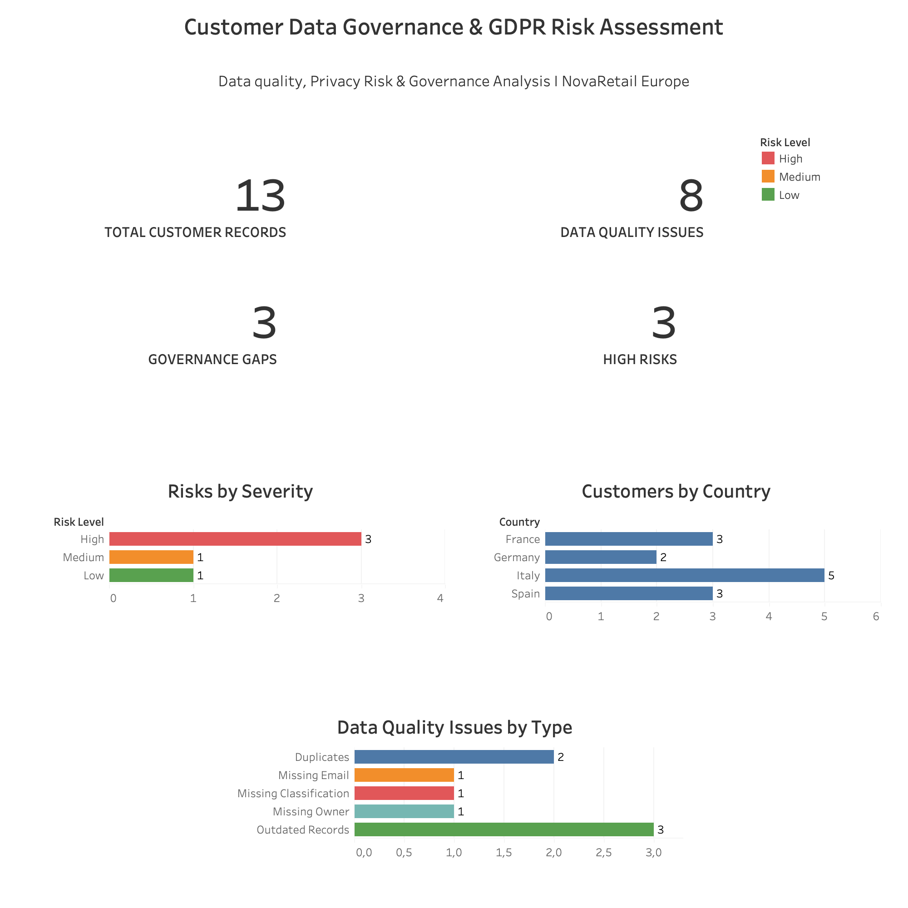

# Customer Data Governance & GDPR Risk Assessment

A portfolio project based on a fictional European retail company, **NovaRetail Europe**, using a small synthetic dataset.

I created this project to practise how data quality, privacy and governance issues can be identified, assessed and presented in a clear way.

## Project overview

The project focuses on a few practical questions:

- Are customer records complete and up to date?
- Are data ownership, classification and retention clearly documented?
- Are consent records properly recorded?
- Which issues should be reviewed first?

## Tools

- **Excel** – data quality checks, consent review and risk register
- **PostgreSQL / SQL** – data exploration and quality checks
- **Tableau** – dashboard and visual reporting

## What I found

The analysis identified:

- **13** customer records
- **8** data quality issue flags
- **3** governance gaps
- **5** risks in the risk register
- **3** High-rated risks

The data quality checks included duplicate records, missing information and outdated records.

The governance review identified missing data classification, missing ownership and an undocumented retention period.

The consent review also highlighted missing evidence for consent and withdrawal dates.

## Dashboard

## Recommended actions

Based on the findings, I would prioritise:

1. Assigning clear data ownership and classification.
2. Documenting and reviewing retention periods.
3. Improving checks for consent and withdrawal dates.
4. Reviewing duplicate and outdated customer records.
5. Tracking open risks and recording when they are resolved.

## Project files

- [Full Project Case Study](NovaRetail_Data_Governance_Case_Study_Final.pdf)
- [Excel Data Governance & GDPR Assessment](Customer_Data_Governance_GDPR_Assessment.xlsx)
- [SQL Analysis](Customer_Data_Governance_Analysis.sql)
- [Tableau Workbook](Customer_Data_Governance_Dashboard.twbx)
- [Dashboard Preview](NovaRetail_Customer_Data_Governance_Dashboard.png)

## What I learned

This project helped me connect data analysis with data governance and privacy work. I also practised turning spreadsheet checks and SQL results into a risk register and a dashboard that can be understood by a non-technical audience.

---

*NovaRetail Europe is fictional. All data used in this project is synthetic and was created for learning and portfolio purposes. The findings do not establish actual GDPR non-compliance.*
